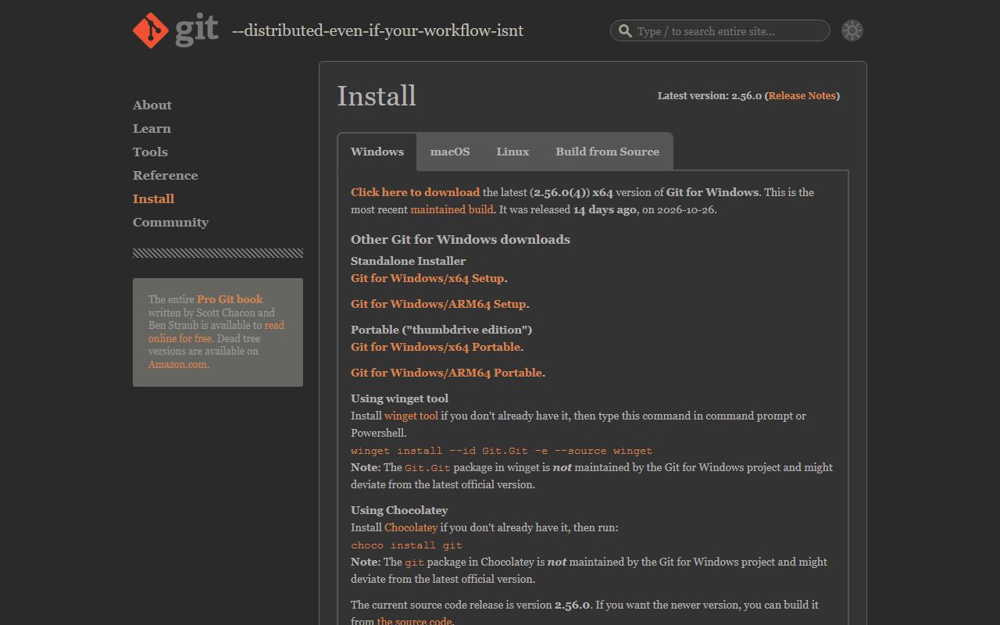
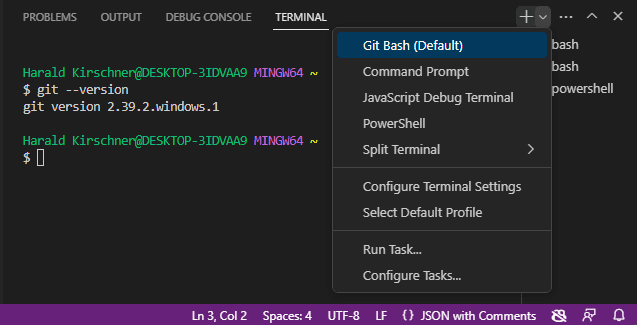
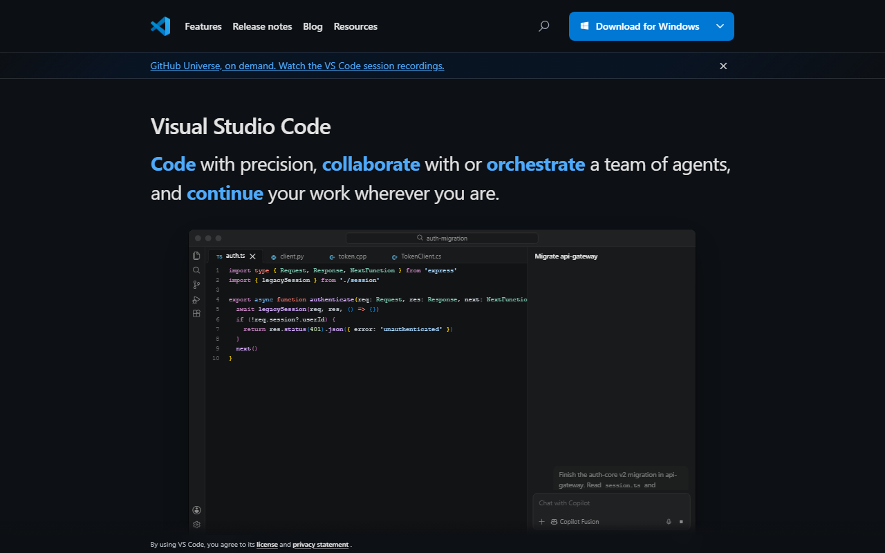
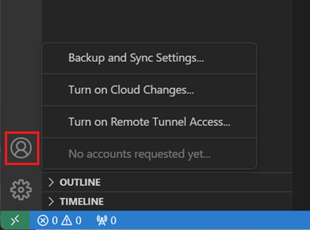
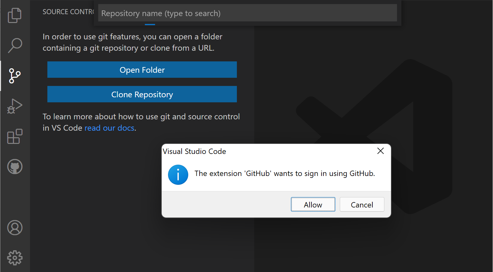
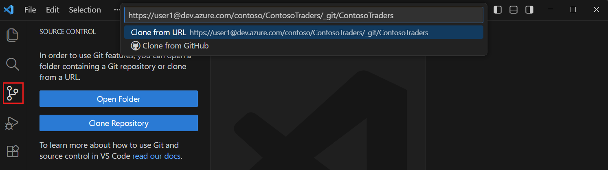
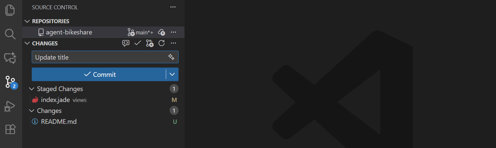
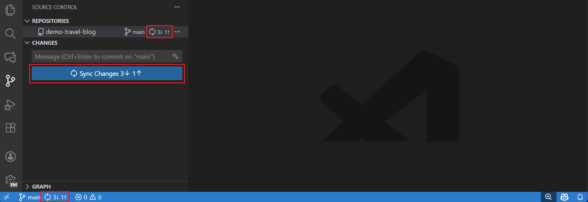

# EcoNest

Setup guide for the EcoNest project. Follow these steps to make a GitHub account, connect it to VS Code, and get this repo on your computer.

---

## 1. Create a GitHub account

1. Go to [github.com/signup](https://github.com/signup).
2. Enter your email, create a password, and pick a username. Your username shows up on everything you push, so choose something you're fine with long term.
3. Solve the puzzle and click **Create account**.
4. GitHub emails you a code. Paste it in to verify your email.
5. Skip or answer the personalisation questions. You'll land on your dashboard.

---

## 2. Install Git

1. Go to [git-scm.com/downloads](https://git-scm.com/downloads) and click **Click here to download**.



2. Run the installer. The default options are fine, just keep clicking **Next**.
3. Open a terminal (in VS Code: **Terminal → New Terminal**) and check it worked:

```bash
git --version
```

You should see something like `git version 2.x.x`.



---

## 3. Tell Git who you are

Use the **same email** you signed up to GitHub with, so your commits link to your account.

```bash
git config --global user.name "your-github-username"
git config --global user.email "you@example.com"
```

Check it saved:

```bash
git config --global --list
```

You should see your `user.name` and `user.email` in the list. You only do this once per computer.

---

## 4. Install VS Code and sign in to GitHub

1. Download VS Code from [code.visualstudio.com](https://code.visualstudio.com) and install it.



2. Click the **Accounts** icon (the person icon, bottom left) and choose **Sign in with GitHub**.



3. If VS Code asks whether the GitHub extension can sign in, click **Allow**.



4. Your browser opens. Click **Authorize Visual Studio Code**, then allow it to open VS Code again.

---

## 5. Clone this repo

"Cloning" downloads this repo to your computer so you can work on simultaneously with others.

**In VS Code:**

1. Open a new VS Code window (**File → New Window**).
2. Click the **Source Control** icon on the left sidebar, then **Clone Repository**.
3. Paste this URL and press **Enter**:

```
https://github.com/ammarshaffy1515/econest-oop.git
```



4. Pick a folder to save it in (e.g. `Documents`).
5. Click **Open** when VS Code asks if you want to open the cloned repo.

**Or from the terminal:**

```bash
git clone https://github.com/ammarshaffy1515/econest-oop.git
cd econest-oop
code .
```

---

## 6. Everyday workflow

1. Before you start working, click **Sync Changes** (or run `git pull`) to get everyone else's latest code.
2. Edit your code and save.
3. In **Source Control**, type a short message describing the change (e.g. `add login page`) and click **Commit**.



4. Click **Sync Changes** to push it to GitHub.



Same thing from the terminal:

```bash
git pull
git add .
git commit -m "add login page"
git push
```

> To push to this repo you need to be added as a collaborator. Send your GitHub username to me(Ammar)!

---